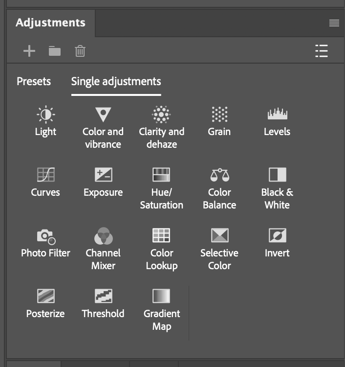

# {{ $frontmatter.title }}

Adjustment Layers are the central tool we use to modify the look of our image.
Each Adjustment Layers is a specific tool that allows us to modify the values of our image's pixels differently.

## Adjustment references

<ChildPages />
